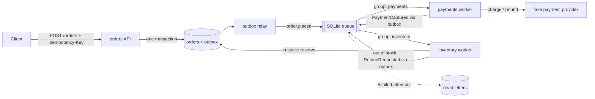

# order-pipeline

An event-driven order system that shows the patterns that keep distributed systems correct when things fail. An orders API, an outbox relay, a payments worker, and an inventory worker talk through a durable message queue built on SQLite. The queue has topics, consumer groups, visibility timeouts, at-least-once delivery, ack and nack, a retry limit, and a dead-letter queue. A chaos script pushes 500 orders through while it kills workers mid-message, fails 30% of payment calls, publishes duplicates, and drops acks. Then it checks that the money and the stock still add up.

## Why

Any system that moves money through a queue faces the same failures. A worker crashes after charging a card but before recording it. The broker delivers a message twice. A client times out and retries the same order. Stock runs out after payment has already been taken. Each one causes a double charge, lost stock, or an order stuck in limbo unless the design handles it on purpose. This project handles each one with a standard pattern, and proves it with invariant checks instead of claims.

| Failure | Pattern used here | Where |
|---|---|---|
| Client retries `POST /orders` after a timeout | Idempotency key, stored with a hash of the request body | `api.py` |
| Order saved but event lost (or event sent for an order that rolled back) | Transactional outbox: order row and `OrderPlaced` event commit in one transaction | `api.py`, `events.py`, `services/relay.py` |
| Same message delivered twice | Idempotent consumer: dedupe table keyed on event id, written in the same transaction as the side effects | `services/worker.py` |
| Worker dies after charging, before recording | Provider idempotency key (`charge:<order_id>`) so the retry returns the first charge | `services/payments.py`, `provider.py` |
| Payment provider returns 503 | Retry with exponential backoff and full jitter, then dead-letter after 5 attempts | `services/worker.py` |
| Malformed message | Poison message goes straight to the DLQ, no retries | `services/worker.py` |
| Out of stock after payment | Saga with a compensating refund | `services/inventory.py`, `saga.py` |
| Two workers race for the last unit | Conditional decrement (`UPDATE ... WHERE stock >= qty`) plus a `CHECK (stock >= 0)` constraint | `services/inventory.py`, `db.py` |

## Architecture



Every service writes its own events through the outbox, so no service ever changes state without its event, or emits an event for a change that rolled back. The relay is the only component that publishes.

Saga states for one order:

```
PENDING --charged--> PAID --stock reserved--> COMPLETED
   |                  |
   |                  +--out of stock--> REFUND_PENDING --refunded--> REFUNDED
   v
PAYMENT_FAILED (message in DLQ) --replayed and charged--> PAID
```

Every transition is written to `saga_log`. `GET /orders/{id}` and `orderpipeline saga <order_id>` show the history. Invalid transitions raise an error.

Correlation ids: the API takes `X-Correlation-ID` (or makes one), stores it on the order, and puts it in every event's headers. Each worker sets it before handling a message, so every JSON log line for one order shares the same id, across all four processes:

```
{"logger": "orderpipeline.api", "msg": "order placed", "correlation_id": "corr-1", "order_id": "ord_680baa24f373", ...}
{"logger": "orderpipeline.relay", "msg": "event published", "correlation_id": "corr-1", "topic": "order.placed", ...}
{"logger": "orderpipeline.payments", "msg": "payment captured", "correlation_id": "corr-1", "charge_id": "ch_985473c12b40", ...}
{"logger": "orderpipeline.inventory", "msg": "inventory decision", "correlation_id": "corr-1", "outcome": "reserved", ...}
```

## How to run

Needs Python 3.11+ and [uv](https://docs.astral.sh/uv/). Docker is optional.

```bash
cd order-pipeline
uv sync --python 3.12

# Everything in one process: API, relay, 2 payments and 2 inventory workers on threads.
# Places 44 orders (4 are bulk orders that run a SKU out of stock), then prints
# saga states, one refund saga, the invariant checks, and a /metrics excerpt.
uv run orderpipeline demo --fresh

# The chaos run: 500 orders with failures injected, then invariant checks.
uv run python scripts/chaos_demo.py
```

Each service as its own process, sharing one database file:

```bash
export ORDERPIPELINE_DB_PATH=data/orderpipeline.db
uv run orderpipeline api --port 8000 &
uv run orderpipeline relay &
uv run orderpipeline payments &
uv run orderpipeline inventory &

curl -X POST localhost:8000/orders -H 'Idempotency-Key: order-1' \
  -H 'content-type: application/json' -d '{"customer_id":"c1","sku":"SKU-MUG","qty":1}'
curl localhost:8000/healthz
curl localhost:8000/metrics
```

Operating the queue:

```bash
uv run orderpipeline queue depth                 # deliveries by topic, group, state
uv run orderpipeline queue dlq                   # dead letters with error and order id
uv run orderpipeline queue replay --topic order.placed   # or --id 414 --id 551
uv run orderpipeline saga                        # orders by saga state
uv run orderpipeline saga ord_3d7a860f5e15       # one order's saga history
uv run orderpipeline check                       # run the invariant checks
```

Settings and chaos knobs are environment variables with the prefix `ORDERPIPELINE_` (see `.env.example`): provider failure rate and latency, seed, max attempts, visibility timeout, backoff, `CRASH_RATE` (kill a worker mid-message), `DUPLICATE_RATE` (publish a message twice), `DROP_ACK_RATE` (lose an ack so the broker redelivers), and `CRASH_EXITS_PROCESS` (exit the process on a crash so Docker or Kubernetes restarts it, instead of restarting in-process).

The `Makefile` wraps these: `make install test lint demo chaos`.

## Chaos run: real output

From `uv run python scripts/chaos_demo.py` on a MacBook (Python 3.12). Crash points are right after a charge (money moved, database not updated), right after a refund, before an ack, and between the relay's publish and its "published" mark.

```
chaos run: 500 orders, seed 42, provider failure rate 0.3, crash rate 0.03, duplicate publish rate 0.05, dropped ack rate 0.03, max attempts 5
finished in 9.1s, pipeline drained: True
client retries with the same Idempotency-Key: 48
orders by final state: COMPLETED 379, PAYMENT_FAILED 1, REFUNDED 120
message outcomes: crashed 63, dead_lettered 1, duplicate 173, ok 1074, retry 316
dead letters: 1

[PASS] every paid order is charged exactly once: 499 paid orders, 499 provider charges, 0 charged twice, 0 charges with no payment record
[PASS] no stock goes negative: min stock 0, 0 SKUs where stock used != reserved
[PASS] every failed order is refunded or in the DLQ: 121 orders did not complete: 120 refunded, 1 in DLQ, 0 unresolved
[PASS] totals reconcile: charged 13801.00, refunded 2304.00, net 11497.00 = completed 11497.00 + parked in DLQ 0.00
[PASS] one OrderPlaced event per order: 500 orders, 500 OrderPlaced events

ALL INVARIANTS HOLD

phase 2: provider healthy again, operator replays the DLQ
replayed 1 dead letters in 0.7s, drained: True
orders by final state: COMPLETED 379, REFUNDED 121
dead letters left: 0

[PASS] every paid order is charged exactly once: 500 paid orders, 500 provider charges, 0 charged twice, 0 charges with no payment record
[PASS] no stock goes negative: min stock 0, 0 SKUs where stock used != reserved
[PASS] every failed order is refunded or in the DLQ: 121 orders did not complete: 121 refunded, 0 in DLQ, 0 unresolved
[PASS] totals reconcile: charged 13843.00, refunded 2346.00, net 11497.00 = completed 11497.00 + parked in DLQ 0.00
[PASS] one OrderPlaced event per order: 500 orders, 500 OrderPlaced events

ALL INVARIANTS HOLD
```

How to read it: 173 messages arrived more than once and were skipped by the dedupe table. 63 times a worker died mid-message and the message came back after its visibility timeout. 316 provider failures were retried with backoff. One order used up all 5 attempts and went to the DLQ; after the replay it was charged and then refunded because its SKU had sold out in the meantime. Refunds come from the stock-out saga: 120 orders were paid, found no stock, and got their money back.

Every fault decision is a hash of the seed and the message, so the same seed injects the same faults. Thread timing still decides which orders reach the last units of a SKU first, so exact counts can move by a few between runs. The invariants hold on every run. "Parked in DLQ" counts money whose next step is waiting in the DLQ, for example a charge that went through just before the worker died on its final attempt. Replaying the DLQ settles it, because the retry reuses the same provider idempotency key.

## Mapping to real brokers

Services only see the `MessageQueue` interface in `queue/base.py`: `publish`, `receive`, `ack`, `nack`, `depth`, `dead_letters`, `replay`. The SQLite version is about 250 lines. Here is how each piece maps:

| This project | Amazon SQS (+ SNS) | Kafka | RabbitMQ |
|---|---|---|---|
| topic | SNS topic | topic | exchange |
| consumer group (each gets every message) | one SQS queue subscribed to the topic | consumer group | one queue bound to the exchange |
| competing workers in a group | multiple pollers on one queue | consumers in a group, one per partition | multiple consumers on one queue |
| `receive(visibility_timeout=...)` | `ReceiveMessage` with `VisibilityTimeout` | poll; no per-message lease, the offset is the lease | `basic.get` / prefetch; unacked messages return when the channel closes |
| `ack` | `DeleteMessage` | commit offset | `basic.ack` |
| `nack(delay=...)` | `ChangeMessageVisibility` | no native delay: retry topic or pause partition | `basic.nack` + delayed-retry exchange or TTL queue |
| `max_attempts` then DLQ | redrive policy `maxReceiveCount` + DLQ | retry and DLQ topics (application side) | `x-dead-letter-exchange` + delivery limit (quorum queues) |
| `replay` | DLQ redrive | reset offsets, or re-publish from the DLQ topic | shovel from DLQ back to the main queue |
| message `key` | `MessageGroupId` (FIFO queues) | partition key, gives per-key ordering | routing key |

Two differences matter most. Kafka tracks progress with one offset per partition, not one lease per message, so a slow message blocks the ones behind it in that partition; retries usually move to a separate topic. SQS standard queues can reorder and duplicate messages, which is fine here because every consumer is idempotent and no handler depends on order.

## Tests

49 tests, all passing (`uv run pytest -q`, about 7 seconds). None call a paid API.

- **Queue semantics (15):** fan-out to every group, competing consumers never share a lease, FIFO within a topic, ack, nack with delay, redelivery after the visibility timeout (with a fake clock), stale receipts cannot ack, DLQ after max attempts by nack and by repeated crashes, poison straight to DLQ, replay, depth counts, durability across reopen.
- **API (13):** order plus outbox event, same idempotency key returns the same order with no duplicate, reused key with a different body is rejected, missing key, unknown SKU, outbox failure rolls back the order (atomicity), correlation id into event headers, saga history, `/healthz`, four `/metrics` series.
- **Pipeline (15):** relay publishes once, relay crash republishes, happy path, duplicate delivery never double charges with provider idempotency switched off, the control case that does double charge without dedupe, retry with backoff, retries exhausted to DLQ and `PAYMENT_FAILED`, DLQ replay completes the order, poison message, crash after charge, lost ack, out-of-stock refund saga, no overselling, invalid saga transition, JSON log carries the correlation id.
- **Invariants (6):** a seeded chaos run of 120 orders drains and passes every check (and really did retry and dedupe), DLQ replay settles everything, and the checker catches a planted double charge, a stuck order, and stock that does not match reservations. The database refuses negative stock.

```bash
uv run pytest -q
uv run ruff check .
```

## DevOps

- `Dockerfile`: one multi-stage image built with uv, non-root user, `HEALTHCHECK`. The command picks the service: `docker run orderpipeline:local payments`. The API health check calls `/healthz`; workers write a heartbeat file each loop and `orderpipeline healthcheck` checks its age.
- `docker-compose.yml`: `api`, `relay`, `payments`, and `inventory` as separate containers from the same image, sharing one volume for the database. Workers set `CRASH_EXITS_PROCESS=true` and `restart: unless-stopped`, so a chaos crash is a real container restart.
- `.github/workflows/ci.yml`: ruff, pytest, the 500-order chaos run (fails the build if any invariant breaks), Docker build, a smoke test of the built image, and `docker compose config`.
- `deploy/k8s/`: a Deployment per service, a Service for the API, liveness and readiness probes (HTTP `/healthz` for the API, the heartbeat exec probe for workers), resource requests and limits, a ConfigMap, Prometheus scrape annotations, and a kustomization. The relay runs one replica with the `Recreate` strategy so two never publish at once.

Docker is not installed on the machine this was built on, so the Docker and Kubernetes files have not been run locally. CI builds and smoke tests the image. Everything also runs without Docker with plain `uv run`.

The Kubernetes manifests are illustrative. They share one SQLite file on a ReadWriteOnce volume, which only works when every pod lands on the same node. On a real cluster SQLite would be replaced by Postgres (orders, outbox, dedupe, saga tables) plus a real broker (SQS, Kafka, or RabbitMQ) behind the same `MessageQueue` interface.

## Production notes

- **Database and broker:** Postgres for state and a managed broker for the queue. The outbox relay would become change data capture (Debezium reading the Postgres WAL) or a relay that claims rows with `SELECT ... FOR UPDATE SKIP LOCKED`, so it can run with more than one replica.
- **Metrics:** here workers write counters to the shared database so the API's `/metrics` shows the whole pipeline. At scale each process exposes its own `/metrics`, Prometheus scrapes them all, and alerts fire on DLQ size above zero, outbox lag, and p99 processing latency.
- **Reconciliation:** a nightly job compares the provider's ledger with the payments table and flags charges with no matching order, the same check the invariant script runs. Real providers send webhooks that feed this.
- **Retention:** acked messages and old `processed_events` rows are kept forever here. In production the dedupe window would be bounded (for example 7 days, longer than the broker's maximum redelivery window) and messages would expire by retention policy.
- **Ordering and partitioning:** order events would be keyed by order id so one order's events stay in order on one partition, while different orders process in parallel.
- **Tracing:** the correlation id would become a W3C `traceparent` header with OpenTelemetry spans per handler, so one trace shows the API call, every hop, and every retry.

## License

MIT. See [LICENSE](LICENSE).
